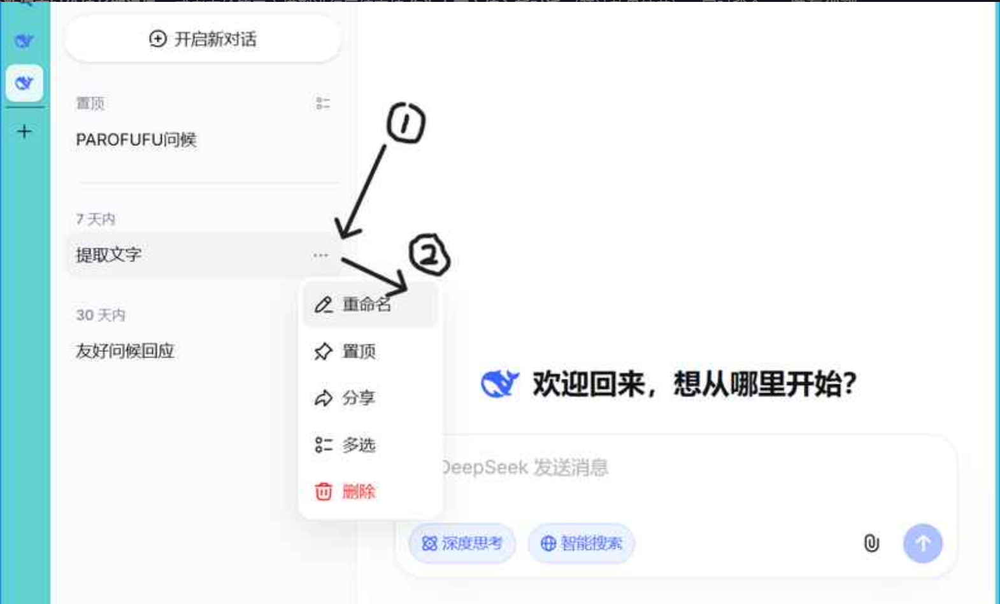
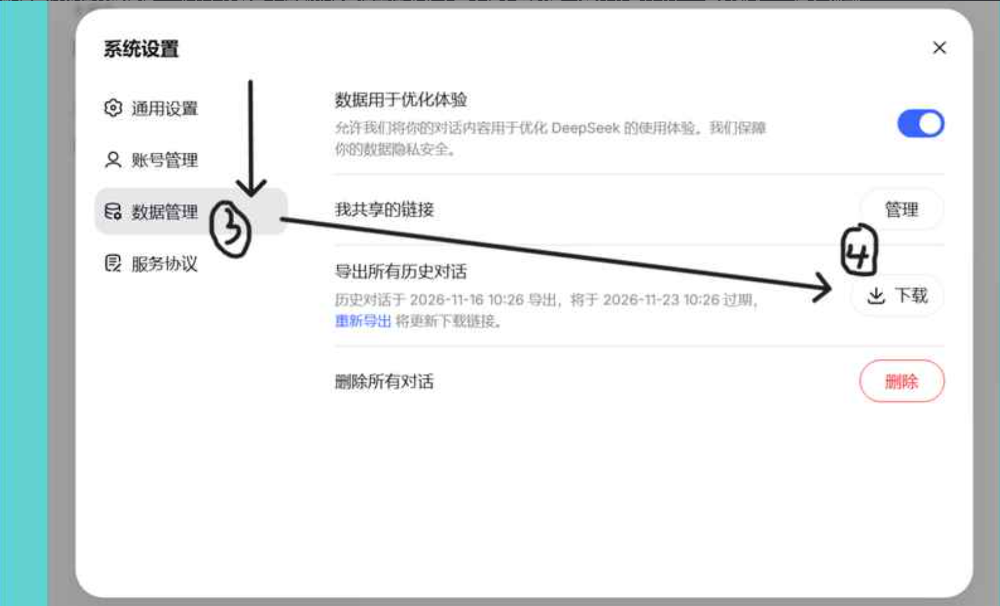
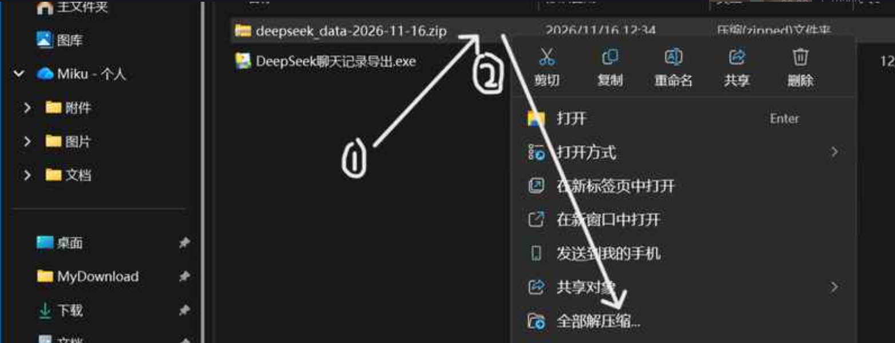
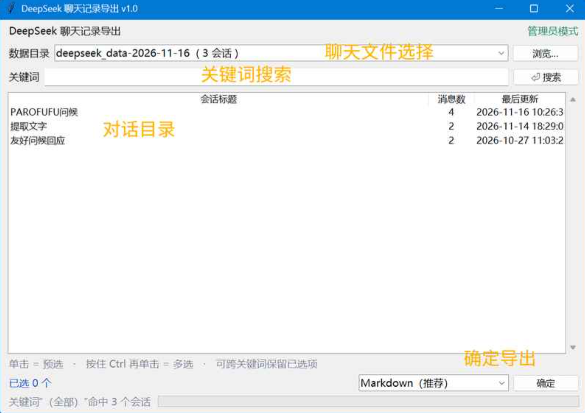
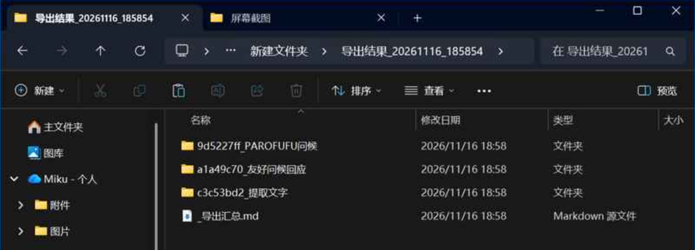

# DeepSeek 客户端聊天记录导出详细教程

> 出于政策管控、成本控制与模型训练强度增强的原因，移动端 DeepSeek 正在逐步收紧安全审查，同时对上下文长度、缓存时间以及免费额度做了限制。为此，本篇文章教授大家如何导出一份**无损的 Markdown 格式聊天记录**。这样的聊天记录可以用作**自建 RAG 数据库以维持长期记忆**，或者交给第三方模型进行压缩，直接**作为上下文接入新对话**（预计效果较差）。同时我会在末尾附上我自制的工具，工具完全开源免费，不用额外安装任何依赖。

## 01 先给对话改个名

首先打开 **DeepSeek**，这里使用网页版做演示。对你想要导出的对话**重命名**，改成一个简单的名字，同时**置顶**，方便搜索。

## 02 从客户端导出数据

点击左下角三个点，选择**系统设置**。

进入后选择**数据管理**，点击**导出**。这里由于我刚进行过导出，所以显示为“下载”；正常流程下点击导出后等待一段时间，会变成如图示的**下载**，再点击下载。

下载完成后得到一个压缩包，命名方式是 `deepseek_data-YYYY-MM-DD`，右键解压缩。

## 03 用导出工具检索并导出

右键聊天记录导出程序，选择**以管理员身份运行**。等待一段时间，它会自动检索当前目录下的聊天记录，生成一个方便检索的目录，并且支持多聊天文件；下次还需要导出时，不必删掉原有的文件。

**左键选择，确定键导出，按住 Ctrl 再左键可以多选。**

前文提到，重命名成简单标题，就是为了在这里方便搜索；置顶可以让对话在对话目录里处于前部。

导出后会生成一个带时间戳的文件夹。进入后是罗列出来的聊天记录文件夹和导出汇总（无用）；在聊天记录文件夹中，有存有上下文的 Markdown 文件和附件文件夹，文件夹内有这个对话下的图片文件。

遗憾的是，官方导出的聊天记录附件形式只限图片。在 JSON 里有一个名为 `is_image` 的键，用来标定是否为图片；若需要导出除图片以外的附件，只能回到客户端手动下载，或者找到源文件。

## 04 没有电脑也能用

以上就是获取完整聊天记录的教程。倘若没有电脑、无法运行 exe，还有使用 Python 脚本的方法。推荐直接交给移动端 agent（如 TRAE）完成，使用云端电脑工作环境来运行。

将导出的聊天记录与 Python 脚本一并发给 agent，使用这段提示词（请对占位符进行替换）：

> 请解压我提供的 zip，用附带的 Python 程序扫描数据目录，按标题关键词「{{关键词}}」列出全部命中会话；先告诉我数量与完整标题，等我确认后，再用 `--export --format md` 导出，并依据 `_导出汇总.md` 汇报导出的会话数、附件状态与自检结果。

所有工具均已上传 GitHub 与网盘，可以加群或者自主获取。

---

## 下面的内容不是教程，只是一些科普

### 为什么不直接使用软件导出的原生 JSON 文件？

> 可能有人会问：“既然大模型那么聪明，我直接把导出的原始 JSON 文件扔给它，让它自己分析不就好了？为什么还要多此一举，用 Python 脚本转成 Markdown？”
>
> 核心原因在于：大模型（LLM）本质上是一个基于概率的“文本预测器”，而不是一个结构化的“数据库解析器”。
>
> 直接给大模型喂原生 JSON，会遇到以下四大“致命伤”：
>
> #### 1. 高昂的 Token 开支，性价比极低
>
> JSON 是一种为了机器解析而设计的格式。为了保证结构的严谨，它包含了大量的冗余符号：`{}`、`[]`、`"`、`,`、`:` 以及各种转义符（比如 `\n`）。
>
> 在大模型眼里，这些全都是要花钱（消耗 Token）的；即使是免费 AI，也会占用上下文空间。一个 10 MB 的聊天记录导出文件，可能有一半的 Token 都浪费在这些无意义的括号和引号上，留给真正聊天内容的上下文窗口被严重挤压。
>
> #### 2. 跨层级追踪极易迷失
>
> JSON 最典型的特征是深度嵌套。
>
> 它像是一个俄罗斯套娃：对话在一个对象里，消息在一个数组里，附件又在另一个子对象里。人类用 JSON 解析器（如 Python 的 `json.loads`）可以瞬间精准定位，但大模型只能把 JSON“拍扁”成一条长长的文本流来阅读。
>
> 当它读到第 500 行的 `}` 时，很难回溯并准确记住这是第 3 层嵌套的闭合标签。一旦层级深了，模型极易出现“张冠李戴”，把 A 会话的内容安到 B 会话上。
>
> #### 3. 严苛的语法
>
> 自然语言（比如中文、英文）有一点语病，大模型凭借联想能力依然能读懂；但 JSON 不行。
>
> JSON 是一个“全或无”的格式：少一个逗号、少一个引号，或者多了一个换行符，整个文件就会解析失败（Parse Error）。大模型在生成内容时，偶尔会陷入“幻觉”或受到流式输出截断的影响，导致它输出的 JSON 经常少个括号、多个逗号，直接导致下游程序崩溃。
>
> #### 4. 注意力稀释
>
> 当你让大模型在原生 JSON 中“找出含有某关键词的所有对话”时，它需要在充满各种转义字符（如把换行符写成 `\n`，把引号写成 `\"`）的文本流中进行字符串匹配。这种反人类的阅读方式，会严重分散模型注意力，导致它遗漏信息，或者把附件状态看错。

### 为什么用 Python 来处理 JSON？

> 首先明确一点：并不是只有 Python 才能处理 JSON。
>
> C++、Java、Go、Node.js，甚至现代浏览器里的 JavaScript，都能极其精准地解析 JSON。如果单论解析速度或内存占用，Python 甚至不是最快的那个。
>
> 但为什么在我们的教程里，提供的是 Python 脚本？
>
> 因为 Python 是当前与 LLM（大语言模型）相性最好的语言，没有之一。
>
> 1. **生态的绝对统治**：目前几乎所有主流的大模型 SDK（如 OpenAI、DeepSeek 等）、Agent 框架（如 LangChain、AutoGen）和数据处理工具，第一语言都是 Python。
> 2. **极致的开发效率**：Python 处理文本、正则、文件系统极其方便。你不仅可以用它来把繁杂的 JSON 转换成干净的文本，还可以在同一个脚本里直接调用大模型的 API，实现“提取—清洗—总结”的无缝自动化。
> 3. **胶水语言的优势**：如果你的数据源五花八门（比如有 txt、有 json、有 docx），用 Python 几行代码就能把它们全部统一成标准格式。它是搭建整个自动化工作流最省心、也最不可少的一环。

### 为什么要把最终形式变成 Markdown？

> 既然不直接喂 JSON，那为什么不导出成 TXT 纯文本，或者 HTML、Word、PDF，非得是 Markdown？
>
> 因为 Markdown 是目前最适合大模型“阅读”和“思考”的黄金格式。原因有以下几点：
>
> 1. **极致的 Token 性价比**：JSON 是一种为了机器严谨解析而设计的格式，充满了冗余符号（引号、大括号、转义符）。在大模型眼里，这些全是消耗成本的 Token。而 Markdown 的信息密度极高：一个标题只需一个 `#`，一个列表只需一个 `-`。去掉冗余符号后，同样的上下文窗口，你能塞进去多出近一倍的真实聊天内容。
> 2. **完美契合大模型的注意力机制**：大模型是顺着文本序列（一维）去阅读的，而聊天记录和文档逻辑其实是有层级的（多维）。JSON 的层级是物理嵌套，像一个三维迷宫，模型读起来很容易“迷路”；Markdown 的层级是线性路标，它通过 `#`、`**`、`>` 等符号，将三维结构“降维”成平坦的高速公路。模型在读取时，注意力权重会本能地被这些符号吸引，瞬间建立起对内容结构的全局认知，精准找到你需要它处理的那一部分。
> 3. **Markdown 是 AI 的原生语料**：如果你去查阅大模型的训练语料，会发现 GitHub 的开源代码、技术文档、维基百科等内容占据了极大比例，而这些内容绝大多数都以 Markdown 格式存在。大模型对它有着极低的认知门槛，能瞬间识别出哪里是用户的提问、哪里是 AI 的回答，比读没有任何排版的 TXT 纯文本要精准得多。
> 4. **极高的抗截断容错率**：还记得前面提到 JSON 少一个括号就全盘崩溃的痛点吗？Markdown 的容错率极高。如果大模型在输出长文时遇到网络中断或达到最大 Token 限制被截断，如果是 JSON，前面的内容可能全废了；但如果是 Markdown，即便只输出了半截，它依然是一段结构清晰、人类和机器都能读懂的文本。
> 5. **方便人类随时介入**：虽然这是给 AI 读的，但你才是最终的控制者。Python 脚本转出来的 Markdown 文件，无论是用 Obsidian、Typora 还是 VS Code 打开，都极其干净。如果导出过程中有隐私内容，你想手动删减修改后再发给 AI，Markdown 对人类来说是最直观、最没有编辑负担的。
